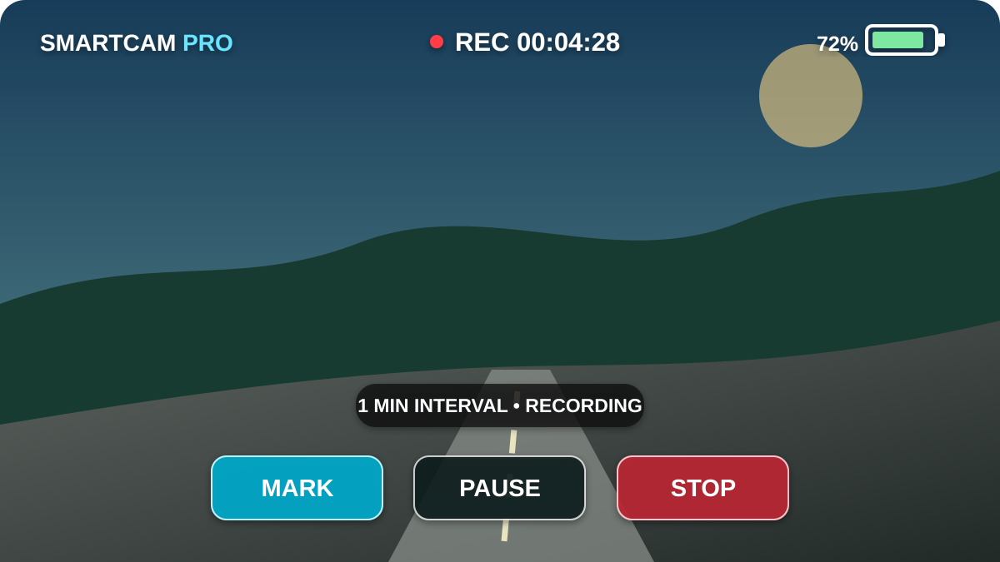
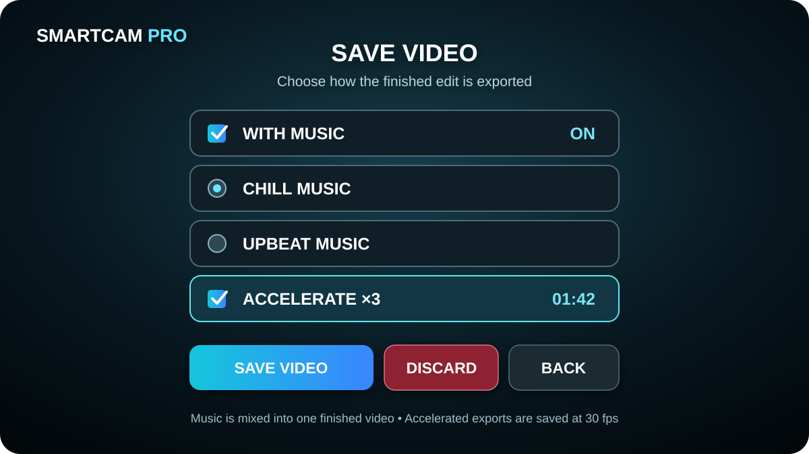

# SmartCam for Rokid AI Glasses

**SmartCam turns Rokid AI Glasses into a hands-free camera that records continuously, keeps the moments you care about, and exports them as one finished video.**

Instead of filling the library with many short interval clips, SmartCam records in the background and combines the selected moments automatically. You can mark highlights while they happen, recover recent moments after they happen with Total Recall, add music, or create a smooth 3× accelerated edit.

[Download SmartCam](SmartCam-Freemium-v2.2.7.apk) · [Activate SmartCam Pro](https://smartcam-pro.pages.dev/)

## Interface

<p align="center">
  
</p>

<p align="center"><em>Record hands-free and press MARK when something worth keeping happens.</em></p>

<p align="center">
  
</p>

<p align="center"><em>Finish the recording as one video, optionally with music or 3× acceleration.</em></p>

## How it works

1. **Start recording.** SmartCam records in one-minute background segments.
2. **Keep the useful moments.** In timed mode it automatically keeps short clips at your chosen interval. Press **NOW** to add an immediate clip.
3. **Mark highlights.** Pro users can press **MARK** to preserve approximately ten seconds before and ten seconds after the moment. Additional marks can extend the highlight.
4. **Choose what to save.** Save the timed edit, marked moments only, or use **Total Recall** to retain roughly the last three minutes in full together with earlier highlights.
5. **Export one video.** SmartCam joins the selected clips into a single file, avoiding a gallery full of separate interval recordings.

You can pause and resume a session before exporting. All finished videos are written to the glasses' media library under `Movies/Camera`.

## Free and Pro

| Feature | Free | Pro |
|---|:---:|:---:|
| Constant recording | ✓ | ✓ |
| Five-second timed clips every minute | ✓ | ✓ |
| **NOW** — capture an extra timed clip | ✓ | ✓ |
| Pause, resume, stop and automatic joining | ✓ | ✓ |
| **MARK** — keep the action around a highlight | — | ✓ |
| **Marked only** export | — | ✓ |
| **Total Recall** — recover the recent past | — | ✓ |
| Additional 3- and 5-minute interval choices | — | ✓ |
| Chill or upbeat soundtrack | — | ✓ |
| 3× accelerated export at 30 fps | — | ✓ |

SmartCam trims the first second from every saved video to remove the camera's black fade-in, so gallery thumbnails begin with visible footage. Very short clips retain enough footage to remain playable.

## Music and accelerated export

Pro exports can include one of the bundled offline soundtrack collections:

- **Chill** for a quieter edit
- **Upbeat** for a more energetic edit

The soundtrack runs continuously across cuts and is fitted to the final video's duration. **Accelerate ×3** produces a 30 fps time-lapse-style export without the original audio; it can be used with or without music.

## Download and install

Download **[SmartCam-Freemium-v2.2.7.apk](SmartCam-Freemium-v2.2.7.apk)**.

- Version: **2.2.7**
- Version code: **43**
- Android package: `com.shabp.rokid.intervalrecorder`
- SHA-256: `9c402a4eda59a71b695bf77f49e3e0d32b417f7c2313598c8f7e1941e918ad57`

Enable developer/ADB access on the glasses, connect them to your computer, and run:

```sh
adb devices
adb install -r SmartCam-Freemium-v2.2.7.apk
```

Use `adb install -r` when updating an existing SmartCam installation. This APK uses the original SmartCam signing certificate, so an in-place update keeps the app's existing data. Grant camera and microphone permissions when prompted.

## Activate Pro

1. Open SmartCam's **Pro** screen on the glasses.
2. Note the device activation code.
3. Open **[smartcam-pro.pages.dev](https://smartcam-pro.pages.dev/)** on a phone or computer.
4. Enter the code and complete the one-time purchase.
5. Return to SmartCam; activation is detected automatically.

The limited-time launch price is **$4.99 USD**, paid once. No subscription is required.

## Compatibility, storage and privacy

- Designed for **Rokid AI Glasses** with APK sideloading enabled.
- SmartCam records in portrait **9:16** format.
- Video and audio processing happens locally on the glasses.
- Finished videos are saved to `Movies/Camera`.
- Internet access is used for Pro activation and entitlement checks, not for uploading recordings.
- Temporary recording segments are managed by the app and are not intended as permanent gallery files.
- Camera and microphone permission are required for video recording with sound.

Recording and audio-consent laws vary by location. Use SmartCam responsibly and respect the privacy of people around you.

## About this repository

This repository is the official public distribution point for the signed SmartCam APK and installation documentation. It does not contain the proprietary application source code.

Copyright © 2026 ShaBP Labs. SmartCam is proprietary software.
